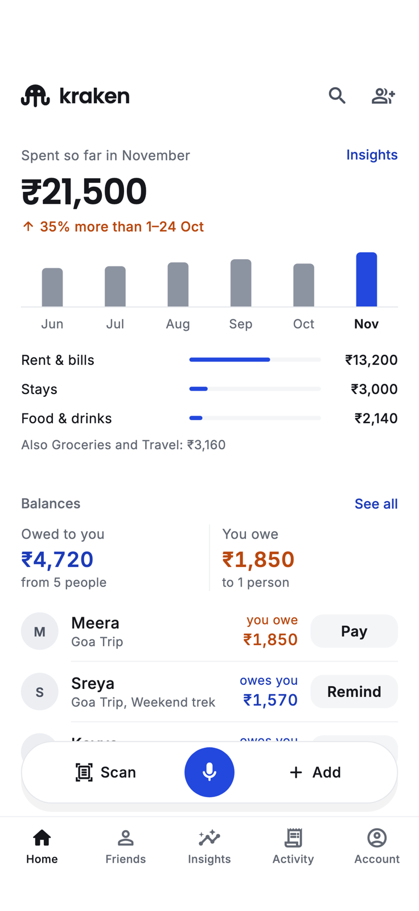
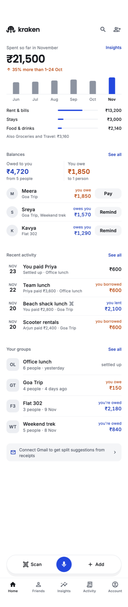
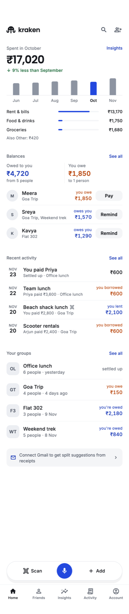
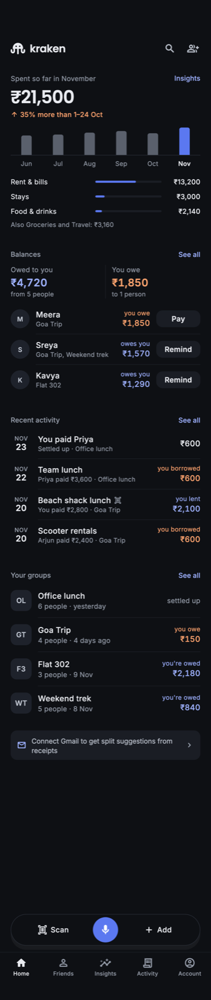

# Home: UX study and redesign

24 Nov 2026 · Status: implemented in the mock flavor (`app/lib/features/home`)

Home is the screen people see every time they open Kraken. This study asks
what it must show so someone understands their money at a glance — what they
spent, who owes whom, and what changed — while staying as quiet as the rest
of the app.

## 1. Why people open Home

Ranked by how often the need comes up and how much it matters when it does.

| # | Job | Question in the person's head | Before | After |
|---|-----|-------------------------------|--------|-------|
| 1 | Check what I spent | "How much have I spent this month, and on what?" | Not answered anywhere | Spending section, first on screen |
| 2 | Clear my debts | "Do I owe anyone? Who's waiting on me?" | Hidden by group netting | Per-person balances with **Pay** |
| 3 | Chase money owed | "Who still owes me?" | Group totals only | Per-person balances with **Remind** |
| 4 | Notice changes | "Did someone add something with me in it?" | Not on Home | Recent activity, last 4 items |
| 5 | Add an expense | "Let me log this quickly." | Action bar | Action bar (unchanged) |
| 6 | Open a group | "Take me to Goa Trip." | Group list | Group list, most recent first |

The first screen has to settle jobs 1–3 without scrolling. Jobs 4–6 can sit
one scroll away, because they either have a dedicated tab (Activity) or a
fixed control (the action bar).

## 2. What was wrong with the old Home

1. **Spending was invisible.** Home showed balances, but nothing about how
   much the person had spent. The Insights design answers it, but only on a
   tab most people won't visit daily.
2. **Group netting hid real debts.** The design's own Goa Trip shows it.
   Home said "you owe ₹150" for the trip, but inside it you owe Meera
   ₹1,850 while Sreya and Arjun owe you ₹1,150 and ₹550. Across all groups,
   the old summary showed *owed ₹3,020 / owe ₹150*; the real picture is
   *owed ₹4,720 from 5 people / owe ₹1,850 to Meera*. The net (₹2,870) is
   the same, but only the second version tells you to pay Meera.
3. **No next step.** Balances had no action, so the most common follow-up
   ("pay her back", "nudge him") meant digging into a group.
4. **No sense of what changed.** Nothing showed recent additions, so an
   expense a friend logged against you went unnoticed until the balance
   looked odd.
5. **Static, decorative copy.** Two banners competed with the content, and
   groups kept a fixed order with a hard-coded "updated 2h ago".

## 3. Principles

1. **Answer the top three questions above the fold**, on a 375×667 phone
   too.
2. **Your share, not the bill.** Spending counts only your part of each
   expense. Settle-up payments are not spending.
3. **Debts per person, not per group.** People settle with people.
4. **Compare like with like.** A month in progress is compared with the
   same days of last month ("35% more than 1–24 Oct"), never with a whole
   month.
5. **Every number leads somewhere.** Insights, Friends, Activity and each
   group are one tap from the figure that summarises them.
6. **Quiet by default.** White page, hairlines, one accent. Colour never
   carries meaning alone: changes have an arrow and words, owe and owed
   have labels.

## 4. Layout, top to bottom

| Order | Module | Answers | Contents | Taps go to |
|-------|--------|---------|----------|------------|
| 1 | **Spending** | Job 1 | Month total (your share); change vs a named period; six-month trend; top 3 categories, the rest summed | Bars switch month; "Insights" opens the tab |
| 2 | **Balances** | Jobs 2–3 | Owed to you / you owe, with how many people; top 3 people, people you owe first, with Pay or Remind | "See all" goes to Friends; Pay/Remind (Phase 6) |
| 3 | **Recent activity** | Job 4 | Last 4 expenses and payments: date, what, who paid, what it did to you, how it was added (voice, scan, Kraken) | "See all" goes to Activity |
| 4 | **Your groups** | Job 6 | Each group, most recently active first, with your balance in it | Group (Phase 2) |
| 5 | Gmail hint | Discovery | One line, until Gmail is connected | Connect (Phase 9) |
| — | Action bar | Job 5 | Scan, hold-to-talk mic, Add; floats above the tabs | — |

The first tab is renamed **Groups → Home**, since it now covers far more
than groups.

## 5. Module details

### Spending

- **Label** names the period: "Spent so far in November" while the month
  runs, "Spent in October" after.
- **Total** in the large figure style, tabular digits.
- **Change** follows the stat-tile rule: signed, against a named period,
  with an arrow and words. Up is drawn in the "owe" colour (spending more
  is the bad direction), down in green, unchanged in grey.
- **Trend:** six columns, one per month. The selected month is the accent
  colour *and* has a bold label, so the choice doesn't rely on colour. Tap a
  column to look at that month; the total, change and categories follow.
- **Categories:** one line each (name, bar, amount), largest first, all in
  one hue. Categories are names, not an order, so colouring them
  differently would only add noise. The rest are summed in words ("Also
  Groceries and Travel: ₹3,160"). Category names match the Insights design.

### Balances

- Two figures, **Owed to you** and **You owe**, each with a head-count
  ("from 5 people", "to 1 person").
- Up to three people. People you owe come first, because they need you to
  act; then the largest amounts. Each row shows the groups the debt comes
  from and one action: **Pay** or **Remind**.
- When everyone is square, the whole module becomes one line: "You're all
  settled up".

### Recent activity

- Expenses and payments together, newest first, using the date block from
  the Group design ("NOV / 20").
- The right-hand column says what it did to *you*: "you lent ₹2,100", "you
  borrowed ₹600", "not involved", or the amount for a payment.
- A small icon marks how it was added: voice, scan, Kraken (agent) or Gmail.
  This is the trust signal for AI-added expenses.

### Your groups

- Most recently active first, so the group you're using rises to the top.
- The subtitle is the head-count plus real recency ("4 days ago",
  "yesterday", "9 Nov").

## 6. States

| State | What Home shows |
|-------|-----------------|
| New account, no groups | "No groups yet" with **Create a group**; no empty charts |
| Month with no spending | ₹0 and "Nothing spent in June"; no category list |
| No earlier months | Total with "Your share of shared expenses" instead of a change |
| Everyone settled | "You're all settled up" in place of the balances module |
| Loading / failed | Spinner / "Couldn't load your groups" with a reason |

## 7. Definitions

All of these are computed in pure Dart (`HomeCalculator`, the `ledger`
package) and unit-tested against hand-checked numbers.

- **Your share of an expense:** your entry in its split, in paise.
- **Spent in a month:** the sum of your shares for expenses dated in that
  month. Payments never count.
- **Comparison:** for the current month, last month from the 1st to the same
  day number (capped at that month's last day); for a past month, the whole
  previous month.
- **Balance with a person:** for every expense you paid, they owe you their
  share; for every expense they paid, you owe them yours; payments move it
  back. Summed across all groups (`balancesWith` in `ledger`).
- **Group balance:** the sum of your per-person balances inside that group.
  This matches the old figures (Goa −₹150, Flat 302 +₹2,180, Weekend trek
  +₹840, Office lunch settled), and the per-person and per-group totals
  always agree on the net (₹2,870).

## 8. Quality checks

| Check | Result |
|-------|--------|
| Chart marks vs page (WCAG 1.4.11, 3:1) | The design's grey bars were 1.68:1, so they were replaced by #8D94A1 (3.05:1 light) and #5A606C (3.01:1 dark) |
| Text contrast (4.5:1) | Owe 5.25, owed 8.87, success 7.13, muted 5.6 (light); 9.72 / 9.15 / 10.43 / 6.81 (dark) |
| Large text (150%) | Category rows and buttons wrap or grow without clipping; no overflow |
| Small phone (375×667) | Spending and both balance totals fit above the action bar |
| Dark mode | Checked separately; accent and status colours re-tuned, not inverted |
| Screen readers | The total reads with "your share"; each month bar reads its name, amount and "selected"; each person row reads as one item, with the button separate |
| Touch targets | Bars use the full column width; Pay/Remind ≥ 84pt wide |
| Reduced motion | Bar and share animations drop to zero duration |

## 9. Measuring it

New analytics event `home_action` (no names or amounts), with `action` set
to one of `month_selected` (plus `months_ago`), `pay`, `remind`,
`see_balances`, `see_activity`, `open_insights`, `open_group` or
`see_groups`.

What to watch once there are real users:

- Share of sessions that tap **Pay**/**Remind** from Home, versus from
  inside a group. If Home wins, the per-person view is doing its job.
- How often `month_selected` is used, and how far back. If people go past
  six months, the trend should grow or link to Insights more strongly.
- Whether expenses added by voice or scan get edited soon after appearing in
  Recent activity. That's a proxy for trust in AI-added expenses.

## 10. Where this departs from the design canvas

1. The first tab is **Home**, not Groups.
2. The month bars use darker greys, so they pass contrast.
3. Balances are per person, not per group, for the reason in §2.2.
4. Groups are ordered by recent activity, not a fixed order.
5. The black balance card and the two hint banners are gone, as part of the
   minimal pass.

## 11. Next

- **Friends tab:** the full per-person list behind "See all", with settle-up
  history (Phase 2 data, Phase 6 actions).
- **Insights:** a year view and the table toggle from the design (Phase 7).
  Home stays a summary.
- **Pay/Remind:** wire to UPI handoff and reminders (Phase 6).
- **Open question:** should personal, non-shared expenses (for example a
  Gmail receipt kept as "Just me") count towards "Spent"? Today they don't;
  counting them would turn Kraken into a general expense tracker.
